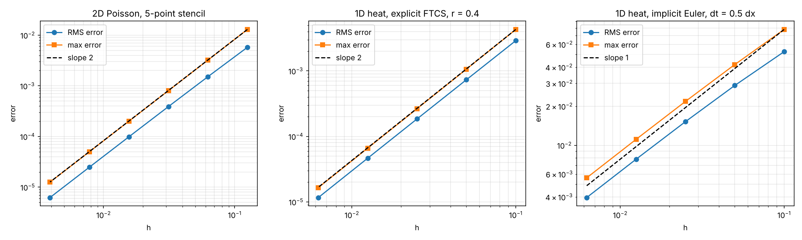

# CFD & Numerical Methods — Python

A collection of Python solvers for classic partial differential equations, written from scratch with NumPy/SciPy as a hands-on path through computational fluid dynamics: from the 1D heat equation up to the 2D incompressible Navier–Stokes equations.


## Projects

| Project | Equation | Methods |
|---|---|---|
| [`heat_equation_1d`](heat_equation_1d) | $u_t = \alpha u_{xx}$ | Explicit FTCS (stability $r = \alpha \Delta t / \Delta x^2 \le 1/2$); implicit Euler with a tridiagonal banded solver |
| [`linear_advection_1d`](linear_advection_1d) | $u_t + a u_x = 0$ | First-order upwind; Crank–Nicolson in time with upwind in space; time-dependent inflow boundary condition |
| [`nonlinear_advection_1d`](nonlinear_advection_1d) | $u_t + (u^2/2)_x = 0$ (inviscid Burgers) | Non-conservative vs. conservative form (shock speed); finite-volume update with Rusanov, Lax–Friedrichs and Lax–Wendroff numerical fluxes |
| [`burgers_1d`](burgers_1d) | $u_t + (u^2/2)_x = \nu u_{xx}$ (viscous Burgers) | Explicit scheme with adaptive time step (convective + diffusive limit); semi-implicit IMEX scheme (explicit flux, implicit diffusion); Rusanov, Lax–Friedrichs and Lax–Wendroff numerical fluxes; Dirichlet, Neumann and time-dependent boundary conditions |
| [`advection_diffusion_2d`](advection_diffusion_2d) | $u_t + a u_x + b u_y = \nu \nabla^2 u$ | Finite-volume update with Rusanov (upwind), central and Lax–Wendroff numerical fluxes for convection, centered differences for diffusion, CFL-based time step, Dirichlet inflow and zero-gradient outflow boundaries |
| [`poisson_2d`](poisson_2d) | $-\nabla^2 p = f$ | 5-point stencil, sparse direct solver; Dirichlet case and mixed case with non-homogeneous Neumann conditions imposed through ghost nodes |
| [`cavity_flow`](cavity_flow) | 2D incompressible Navier–Stokes | Chorin projection method, pressure Poisson equation with LU factorization reused at every step, validated against Ghia et al. (1982) at Re = 100 |
| [`convergence_study`](convergence_study) | Poisson 2D, heat 1D | Grid convergence study against exact solutions, observed order of accuracy |

## Highlights — `cavity_flow`

A modular solver for the lid-driven cavity benchmark at Re = 100 on a 129 × 129 grid.

- **Projection (fractional-step) method:** intermediate velocity without pressure → pressure Poisson equation $\nabla^2 p = \nabla \cdot \mathbf{u}^* / \Delta t$ → divergence-free correction $\mathbf{u}^{n+1} = \mathbf{u}^* - \Delta t \nabla p$.
- **Collocated grid with compatible operators:** $u$, $v$ and $p$ are stored on the same nodes. The divergence in the Poisson right-hand side uses forward differences and the pressure gradient in the correction uses backward differences, so that their composition gives exactly the standard 5-point Laplacian used in the Poisson matrix:
  $D^+_x D^-_x p_i = (p_{i+1} - 2p_i + p_{i-1}) / \Delta x^2$.
  With centered differences for both operators the composition would be a wide stencil ($p_{i+2} - 2p_i + p_{i-2}$) that decouples odd and even nodes and allows checkerboard pressure modes.
- **Pressure Poisson solver:** homogeneous Neumann conditions on the walls, pressure fixed in one node (the pure Neumann problem defines $p$ only up to a constant), sparse LU factorization computed once and reused at every time step.
- **Adaptive time step** from the convective and diffusive stability limits; steady state reached when $\max|u^{n+1} - u^n| < 10^{-6}$.
- **Modular design:** separate modules for grid, boundary conditions, operators, Poisson solver, projection step, visualization and validation.

### Validation

Centerline profiles $u(0.5, y)$ and $v(x, 0.5)$ are compared with the reference data of Ghia, Ghia & Shin (1982) at Re = 100. The solver profiles are linearly interpolated at the 17 reference points and two error measures are computed on the differences $e_i$:

- RMS error $\sqrt{\frac{1}{N}\sum e_i^2}$ (discrete L2 norm normalized by the number of points)
- max error $\max_i |e_i|$ (discrete L∞ norm)

| Profile | RMS error | max error |
|---|---|---|
| $u(0.5, y)$ | 5.2e-3 | 1.3e-2 |
| $v(x, 0.5)$ | 5.4e-3 | 9.5e-3 |

Errors are relative to the lid velocity $U = 1$, i.e. below 1.5 % everywhere.


## Numerical fluxes — `advection_diffusion_2d`

All fluxes share the form $F_{i+1/2} = \frac{1}{2}(f_L + f_R) - \frac{\alpha}{2}(u_R - u_L)$, with a different numerical dissipation $\alpha$:

| Scheme | $\alpha$ (x direction) | Notes |
|---|---|---|
| Rusanov | $\lvert a \rvert$ | for a linear flux it is first-order upwind |
| Central | $0$ | no numerical dissipation; stable here because the cell Péclet number $a\Delta x/\nu \approx 0.5 < 2$ |
| Lax–Wendroff | $a^2 \Delta t / \Delta x$ | second order, applied dimension by dimension |

Gaussian pulse at $t = 0.6$: the peak is 0.26 with Rusanov, 0.29 with Lax–Wendroff and 0.30 with the central flux, showing the extra numerical diffusion of the upwind flux.

Lax–Friedrichs ($\alpha = \Delta x / \Delta t$), used in the 1D codes, is not included in 2D: its numerical viscosity $\Delta x^2 / (2\Delta t)$ per direction exceeds the stability limit of explicit diffusion in 2D, and even the 2D variant with half the dissipation (average of the 4 neighbours) only reaches it. Adding the physical viscosity $\nu$ then makes the odd–even (checkerboard) mode grow and the solution blows up.

## Convergence study

The numerical solution is compared with an exact solution on successively refined grids; the observed order is $p = \log(e_{coarse}/e_{fine}) / \log(h_{coarse}/h_{fine})$.

| Test | Exact solution | Expected order | Observed order (finest grids) |
|---|---|---|---|
| 2D Poisson, 5-point stencil | $\sin(\pi x)\sin(\pi y)$ | 2 | 2.00 |
| 1D heat, explicit FTCS, fixed $r = 0.4$ ($\Delta t \sim \Delta x^2$) | $e^{-\alpha\pi^2 t}\sin(\pi x)$ | 2 | 2.00 |
| 1D heat, implicit Euler, $\Delta t = 0.5\,\Delta x$ | $e^{-\alpha\pi^2 t}\sin(\pi x)$ | 1 (time error dominates) | 0.98 |



## Requirements

```
pip install -r requirements.txt
```

(NumPy, SciPy, Matplotlib)

## Running

Each project is self-contained. Run any script from its folder, e.g.:

```
cd cavity_flow
python main.py
```

Most scripts produce live matplotlib animations or plots of the solution.
